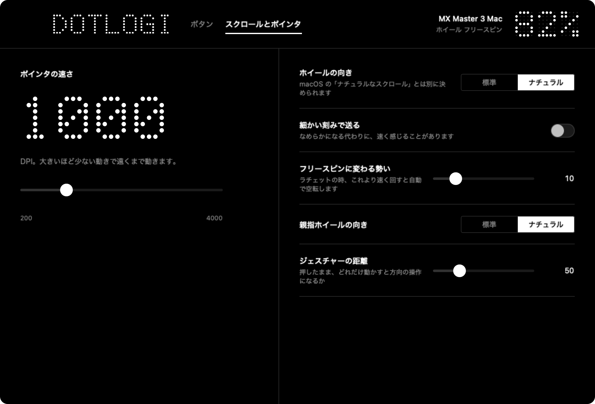
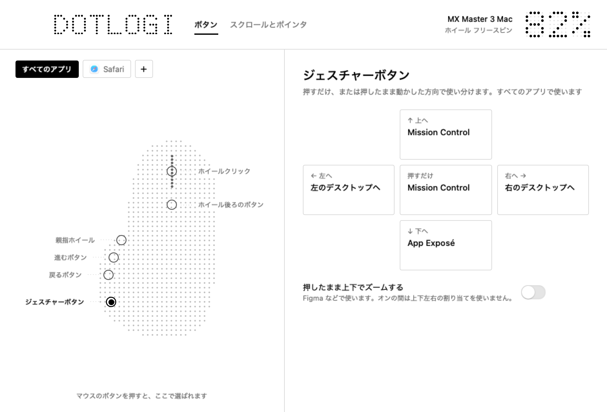

<p align="center">
  
</p>

<h1 align="center">dotlogI</h1>

<p align="center">
  A tiny macOS companion for the <b>Logitech MX Master 3 for Mac</b>.<br>
  It does what most people use Logi Options+ for, in about <b>4 MB of memory and 0% CPU</b> when idle.
</p>


> **Unofficial.** dotlogI is not affiliated with, endorsed by, or supported by Logitech. Logitech, Logi, MX Master
> and Options+ are trademarks of Logitech. dotlogI contains no Logitech code or artwork.

[日本語の説明は下にあります](#日本語)

## Why

Logi Options+ is a large app with several background processes. On the author's Mac, Options+ and its plugin service
used about 400 MB together, for a handful of button assignments. dotlogI keeps those assignments and drops the rest.

| | Logi Options+ | dotlogI |
|---|---|---|
| Memory while idle | about 400 MB (agent and plugin service) | about 4 MB |
| CPU while idle | about 1.6% (agent, one sample) | 0% |
| Background processes | 7 | 1 |
| Account, cloud sync, analytics | yes | none |

## A tour

### Press a button, and the window finds it

The window shows a dot-matrix drawing of the mouse. Press any button on the real mouse and the window selects it,
lit red for a moment, so you never need to know what a button is called. Then choose what it does.

The thumb button and the button behind the wheel each have five slots: press, and hold-and-move up, down, left or
right. Either one can instead zoom while you hold it and move up or down.

### Different apps, different buttons


Pick an app at the top to give it its own assignments. Entries that differ from **すべてのアプリ** (all apps) get a
red dot. Everything else is inherited, shown in grey. Use **+** to add an app. The app in front when you press decides
which assignments apply.

### Scrolling and pointer



These settings are written to the mouse itself: pointer resolution (DPI), wheel and thumb-wheel direction, finer
wheel steps, and how hard a flick switches the wheel from ratchet to free spin (SmartShift). Scrolling stays native.
dotlogI never sits between the wheel and macOS.

### Light or dark



The window follows the macOS appearance. Battery level and wheel mode are shown at the top right.

### First run


When a permission is missing, a banner says which one and opens the right page in System Settings.

The window is in Japanese for now. Changes apply as soon as you make them; there is no Save button.

## What it does

- Reassign the wheel button, back, forward, the thumb gesture button and the button behind the wheel.
- Actions: Mission Control, App Exposé, Launchpad, back, forward, middle click, switch the wheel mode, any key
  chord such as `⇧⌘Z` or `⌃→`, or nothing.
- Per-app assignments.
- Pointer resolution, wheel and thumb-wheel direction, finer wheel steps and the SmartShift threshold.
- Remembers the wheel mode (free spin or ratchet) and restores it when the mouse reconnects.
- Low-battery notification.

Left out on purpose: smooth scrolling, Actions Ring, Flow, macros and Smart Actions, firmware updates, accounts and
cloud sync, analytics, webcam and keyboard settings.

## How it works

The mouse speaks **HID++ 2.0**, the protocol Logitech devices use for configuration. Parts of it are published by
Logitech, and it is implemented in the Linux kernel and in open-source tools such as Solaar and logiops. The agent:

1. Opens the mouse's HID++ interface (vendor usage page `0xFF43`) through IOKit.
2. Diverts the buttons (feature `0x1B04`), so presses arrive as HID++ events instead of normal clicks. The wheels stay
   with the mouse and macOS; dotlogI only sets their direction and resolution (`0x2121`, `0x2150`).
3. Turns those events into actions with CoreGraphics events. Mission Control, App Exposé and Launchpad use the Dock's
   `CoreDockSendNotification`, a private but long-standing API.
4. Re-applies everything whenever the mouse reconnects (feature `0x1D4B`). On exit it hands the buttons back.

Once running, the agent only wakes for mouse events. While a permission is missing, it hands the buttons back and
restarts every 30 seconds to check again, because macOS does not tell a running process that it was granted access.

The agent and the settings window are separate programs. The window runs only while it is open, so the resident
part never loads any UI framework.

## Requirements

- macOS 14 or later to build. It has only been run on macOS 27 on Apple silicon.
- Swift 5.10 or later (the Xcode Command Line Tools are enough)
- MX Master 3 for Mac connected over Bluetooth (product ID `0xB023`). Other models and the Bolt/Unifying receiver are
  untested.

## Status

This is a personal tool that works on the author's Mac. What has and hasn't been tried there:

| Tried | Not tried yet |
|---|---|
| Thumb-button gestures, back/forward, desktop switching, per-app assignments | The `launchpad` action (recent macOS replaced Launchpad with Apps) |
| DPI, wheel direction and SmartShift threshold, read back from the mouse | The `middle-click` action. A remapped wheel button clicks only; it cannot middle-drag |
| Granting permissions and the agent picking them up | Restoring the wheel mode after the mouse is switched off and on |
| Install, update and the settings window | The low-battery notification, and zoom on hold-and-move |

## Install

```sh
git clone https://github.com/Takeaki0817/dotlogI.git
cd dotlogI
scripts/install.sh
```

This builds and installs one app, **/Applications/dotlogI.app**, and a login agent that runs it in the background
(`~/Library/LaunchAgents/local.dotlogi.plist`). Your settings go to `~/.config/dotlogi/config.json` (created once from
`config/default.json`), and the log to `~/Library/Logs/dotlogi.log`.

Then **open dotlogI**. macOS asks for two permissions. Switch **dotlogI** on in both lists:

1. **Input Monitoring**, to read the mouse's buttons
2. **Accessibility**, to send key presses and clicks

The background copy picks them up when you return to the dotlogI window, or within 30 seconds. Opening dotlogI later
just shows the settings window.

**Turn off Logi Options+ first**, or both apps will try to handle the buttons:

```sh
launchctl disable gui/$(id -u)/com.logi.cp-dev-mgr
launchctl bootout gui/$(id -u)/com.logi.cp-dev-mgr
```

Also remove *Logi Options+* from System Settings > General > Login Items. To undo, run `launchctl enable` with the
same label and `launchctl bootstrap gui/$(id -u) /Library/LaunchAgents/com.logi.optionsplus.plist`.

### After an update

The app is ad-hoc signed, so macOS ties its permissions to that exact build. After you rebuild, open dotlogI and
switch it on again in both lists. The installer clears the old entries, so the new one is the only dotlogI listed.

To keep the permissions across your own rebuilds instead, install with `DOTLOGI_LOCAL_SIGNING=1 scripts/install.sh`.
This signs with a local certificate, but then any program running as you could use that certificate to claim
dotlogI's permissions. Read `scripts/signing.sh` before choosing it.

## Configure by hand

The settings window writes `~/.config/dotlogi/config.json`. You can also edit it and reload with
`launchctl kill SIGHUP gui/$(id -u)/local.dotlogi`.

Actions: `mission-control`, `app-expose`, `launchpad`, `back`, `forward`, `middle-click`, `smartshift-toggle`, `none`,
or a key chord such as `cmd+shift+z`, `ctrl+right` or `ctrl+tab`. Modifiers are `cmd`, `shift`, `ctrl` and `opt`.

`profiles.default` applies everywhere. A profile keyed by an app's bundle ID overrides single entries for that app:

```json
"com.google.Chrome": {
  "modeShift": { "click": "cmd+w", "left": "ctrl+tab", "right": "ctrl+shift+tab" }
}
```

`.build/release/DotlogiAgent check` validates the config without touching the mouse. `.build/release/DotlogiAgent
probe` prints the mouse's feature table and current state without changing anything.

## Uninstall

```sh
scripts/install.sh uninstall
```

This stops the agent, hands the buttons back to the mouse, and removes the app, its login agent and its two
permissions. `~/.config/dotlogi` is kept. If you used local signing, also run `scripts/signing.sh remove`.

## Security notes

- The agent holds Accessibility and Input Monitoring. It is signed with the hardened runtime, so injected libraries
  and `DYLD_*` variables are refused. Ad-hoc signing ties the permissions to one exact build.
- **Treat config files as trusted input.** A config cannot run commands, but it can bind a button to any key chord,
  such as `cmd+q`. Only use configs you have read.
- The agent accepts one mouse at a time and limits what a device can make it queue or log.

## Development

`scripts/screenshots.sh` regenerates the images above from sample settings, never from your own.
`scripts/make-icon.swift` draws the icon.

## License

MIT. See [LICENSE](LICENSE).

---

## 日本語

dotlogI は、**Logicool MX Master 3 for Mac** を軽く使うための、macOS 向けの小さなアプリです。Logi Options+ でよく使う
機能（ボタンの割り当て、アプリごとの割り当て、ポインタの速さ、ホイールの向き、SmartShift）だけを残し、常に動く部分は
約 4 MB のメモリで、待機中は CPU を使いません。Logicool の公式アプリではありません。

**使い方**

1. 上の「Install」のコマンドで導入する
2. 「dotlogI」を開き、システム設定の「入力監視」と「アクセシビリティ」で dotlogI をオンにする
3. マウスのボタンを押すと、画面でそのボタンが選ばれるので、割り当てを選ぶ

更新した後は、もう一度 dotlogI を開き、2 つをオンにし直してください。Logi Options+ と同時に使うと、ボタンを取り合います。
上の「Turn off Logi Options+ first」の手順で、先に止めてください。
