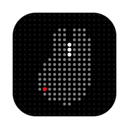
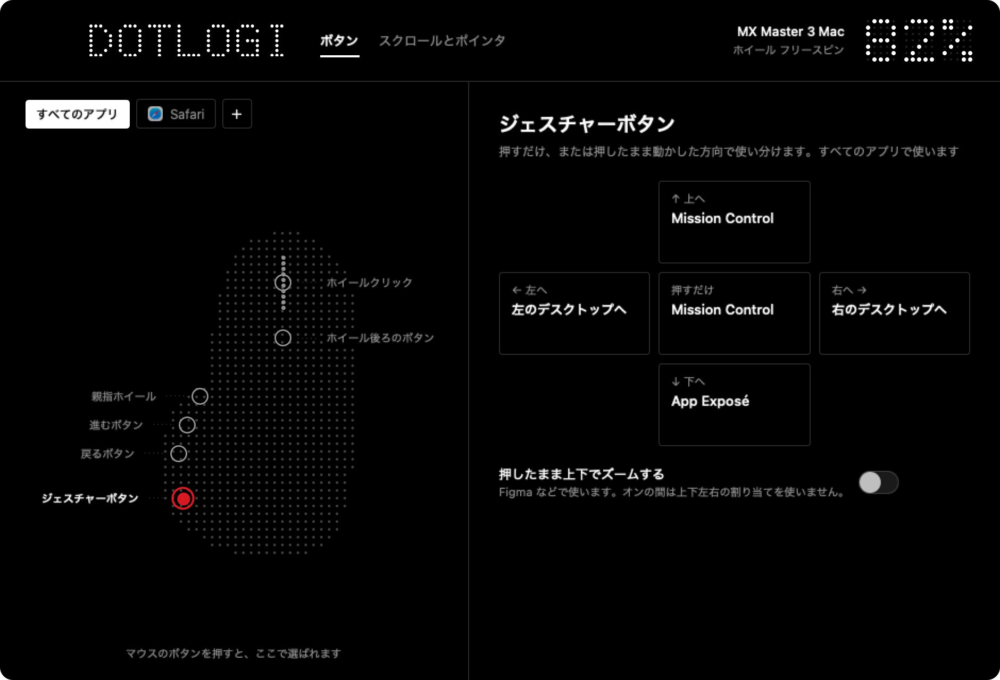
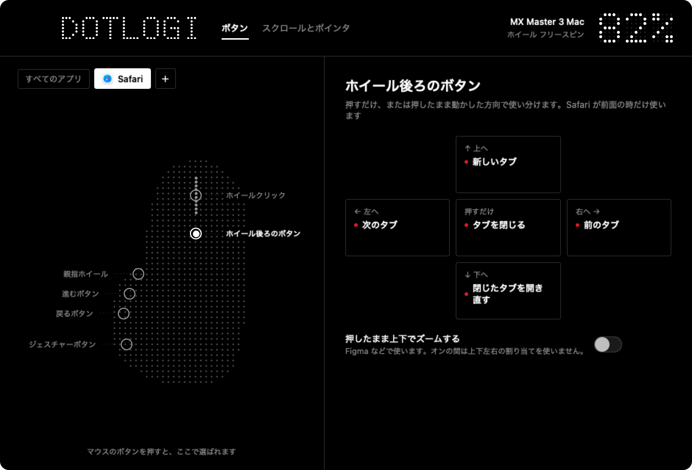
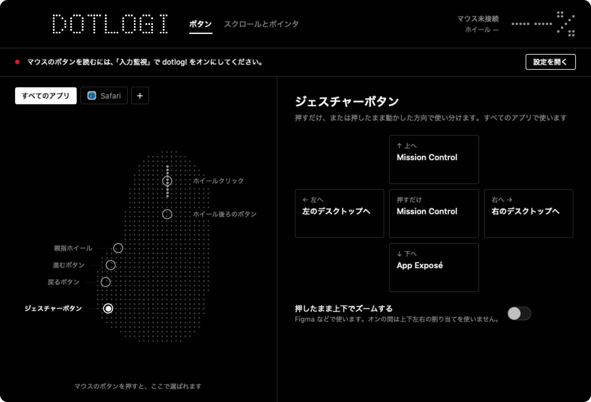

<p align="center">
  
</p>

<h1 align="center">dotlogI</h1>

<p align="center">
  <b>Logicool MX Master 3 for Mac</b> のための、macOS 向けの小さなアプリです。<br>
  Logi Options+ でよく使う機能を、待機中は <b>メモリ約 4 MB、CPU 0%</b> でこなします。
</p>

<p align="center"><sub>An unofficial, lightweight companion for the Logitech MX Master 3 on macOS. The UI is in Japanese.</sub></p>



> **非公式のアプリです。** dotlogI は Logicool（Logitech）とは関係がなく、同社の承認やサポートも受けていません。
> Logitech、Logicool、Logi、MX Master、Options+ は Logitech の商標です。dotlogI には、Logitech のコードも画像も入っていません。

## なぜ作ったか

Logi Options+ は大きなアプリで、裏でいくつもの処理を動かします。作者の Mac では、ボタンをいくつか割り当てるだけのために、Options+ とプラグイン常駐で合わせて約 400 MB のメモリを使っていました。dotlogI は、その割り当てだけを残して、ほかを削っています。

| | Logi Options+ | dotlogI |
|---|---|---|
| 待機中のメモリ | 約 400 MB（設定エージェントとプラグイン常駐） | 約 4 MB |
| 待機中の CPU | 約 1.6%（設定エージェント、1 回の計測） | 0% |
| 常駐する処理 | 7 | 1 |
| アカウント、クラウド同期、利用状況の送信 | あり | なし |

## 画面

### ボタンを押すと、画面がそのボタンを選ぶ

画面には、マウスをドットで描いた図が出ます。実物のマウスのボタンを押すと、画面でそのボタンが選ばれ、一瞬赤く光ります。ボタンの名前を知らなくても、押すだけで設定したいボタンにたどり着けます。あとは、何をさせるかを選ぶだけです。

親指ボタンとホイール後ろのボタンには、それぞれ 5 つの割り当てがあります。押すだけ、押したまま上・下・左・右に動かす、の 5 つです。どちらのボタンも、代わりに「押したまま上下に動かしてズーム」にもできます。

### アプリごとに割り当てを変える



上でアプリを選ぶと、そのアプリだけの割り当てを作れます。「すべてのアプリ」と違う割り当てには赤い点が付き、変えていない割り当ては共通の設定を引き継いで、灰色で表示されます。アプリは「＋」で足せます。どの割り当てを使うかは、ボタンを押した時に前面にあるアプリで決まります。

### スクロールとポインタ


ポインタの解像度（DPI）、ホイールと親指ホイールの向き、どれだけ勢いよく回すとラチェットからフリースピンに切り替わるか（SmartShift）を変えられます。これらはマウス本体に書き込みます。

なめらかスクロールをオンにすると、ホイールを 1 目盛り回すたびに、画面がすべるように動いて止まります。1 目盛りで進む距離と、止まるまでの長さを変えられます。CPU を使うのはホイールを回している間だけで、止まっている時は何もしません。オフにすると、スクロールは macOS の標準に戻り、代わりにホイールの細かい刻みを選べます。

### ライトとダーク


macOS の外観の設定に合わせて切り替わります。右上には、電池の残りとホイールのモードが出ます。

### 初めて開いた時



許可が足りない時は、どの許可が足りないかを案内し、システム設定の該当する画面を開けます。

変えた設定は、すぐに反映されます。保存ボタンはありません。

## できること

- ホイールクリック、戻る、進む、親指のジェスチャーボタン、ホイール後ろのボタンの割り当てを変える
- 割り当てられる操作：Mission Control、App Exposé、Launchpad、戻る、進む、中クリック、ホイールのモードの切り替え、`⇧⌘Z` や `⌃→` のような任意のキーの組み合わせ、何もしない
- アプリごとの割り当て
- なめらかスクロール（1 目盛りで進む距離と、止まるまでの長さを変えられる）
- ポインタの解像度、ホイールと親指ホイールの向き、ホイールの細かい刻み、SmartShift の閾値
- ホイールのモード（フリースピンかラチェットか）を覚えておき、マウスがつながり直した時に戻す
- 電池が減った時の通知

あえて入れていないもの：Actions Ring、Flow、マクロと Smart Actions、ファームウェアの更新、アカウントとクラウド同期、利用状況の送信、Webカメラとキーボードの設定。

## 仕組み

MX Master 3 は、設定のやり取りに **HID++ 2.0** という通信の決まりを使っています。Logicool が仕様の一部を公開していて、Linux カーネルや、Solaar、logiops といったオープンソースのツールも同じ決まりでマウスを設定しています。dotlogI の常駐は、次のように動きます。

1. IOKit で、マウスの HID++ 用のインターフェース（ベンダー定義の usage page `0xFF43`）を開く
2. ボタンの入力を、ふつうのクリックの代わりに HID++ のイベントとして受け取るよう、マウスに設定する（feature `0x1B04`）。なめらかスクロールがオンの時は、ホイールの回転も同じように受け取る（`0x2121`）。オフの時はホイールをマウスと macOS に任せ、向きと解像度だけを設定する（`0x2121`、`0x2150`）
3. 受け取ったイベントを、CoreGraphics のイベントで操作に変える。ホイールの回転は、動き出しと止まり際をゆるやかにしたピクセル単位のスクロールとして送る。Mission Control、App Exposé、Launchpad は、Dock の `CoreDockSendNotification` で呼び出す（公開されていない API ですが、長く使われています）
4. マウスがつながり直すたびに、設定をすべて書き込み直す（feature `0x1D4B`）。終了する時は、ボタンとホイールをマウス本来の動きに戻す

動き出した後の常駐は、マウスからイベントが届いた時にだけ働きます。許可が足りない間は、ボタンをマウス本来の動きに戻し、ホイールも受け取らずに macOS の標準のスクロールのままにして、30 秒ごとに起動し直して許可を確かめ直します。macOS は、動いている途中の処理に「許可された」と知らせないためです。

常駐と設定画面は別のプログラムです。設定画面は開いている間だけ動くので、常駐の側は UI のフレームワークを一切読み込みません。

## 動作環境

- ビルドには macOS 14 以降が要ります。実際に動かしたのは、Apple シリコンの macOS 27 だけです
- Swift 5.10 以降（Xcode の Command Line Tools で足ります）
- Bluetooth でつないだ MX Master 3 for Mac（product ID `0xB023`）。ほかの機種と、Bolt / Unifying レシーバー経由の接続は試していません

## 確かめた範囲

作者の Mac で使っている個人用のツールです。その Mac で試したものと、まだ試していないものは次のとおりです。

| 試した | まだ試していない |
|---|---|
| 親指ボタンのジェスチャー、戻る・進む、デスクトップの切り替え、アプリごとの割り当て | `launchpad` の操作（最近の macOS では、Launchpad はアプリ一覧に置き換わっています） |
| DPI、ホイールの向き、SmartShift の閾値（マウスから読み戻して確認） | `middle-click` の操作。割り当て直したホイールボタンはクリックだけで、中ボタンでのドラッグはできません |
| 許可を出した後に常駐がそれを読み取ること | マウスの電源を入れ直した後の、ホイールのモードの戻し |
| 導入、更新、設定画面 | 電池が減った時の通知、押したまま動かしてズーム |
| なめらかスクロール（速さと止まるまでの長さの調整を含む） | アプリごとの、なめらかスクロールの効き方の違い |

## 導入

```sh
git clone https://github.com/Takeaki0817/dotlogI.git
cd dotlogI
scripts/install.sh
```

アプリ **/Applications/dotlogI.app** が一つと、それを裏で動かすためのログイン項目（`~/Library/LaunchAgents/local.dotlogi.plist`）が入ります。設定は `~/.config/dotlogi/config.json`（初回だけ `config/default.json` から作ります）に、記録は `~/Library/Logs/dotlogi.log` に書かれます。

導入したら、次の手順で許可を出します。

1. 「dotlogI」を開く。macOS が 2 つの許可を求めてきます
2. 「入力監視」で **dotlogI** をオンにする（マウスのボタンを読むため）
3. 「アクセシビリティ」で **dotlogI** をオンにする（キー操作やクリック、なめらかスクロールを送るため）
4. dotlogI の画面に戻る

画面に戻った時か、遅くとも 30 秒以内に、裏の常駐が許可を読み取ります。2 回目からは、dotlogI を開くと設定画面だけが出ます。

**先に Logi Options+ を止めてください。** 両方が動いていると、同じボタンに両方が反応します。

```sh
launchctl disable gui/$(id -u)/com.logi.cp-dev-mgr
launchctl bootout gui/$(id -u)/com.logi.cp-dev-mgr
```

あわせて、システム設定の「一般」→「ログイン項目」から Logi Options+ を外します。元に戻す時は、同じ名前で `launchctl enable` を実行し、`launchctl bootstrap gui/$(id -u) /Library/LaunchAgents/com.logi.optionsplus.plist` を実行します。

### 更新した後

アプリは ad-hoc 署名なので、macOS は許可をそのビルドに結び付けます。作り直した後は、もう一度 dotlogI を開き、2 つの許可をオンにし直してください。導入スクリプトが古い登録を消すので、一覧に出る dotlogI は新しいものだけです。

作り直しても許可を残したい場合は、`DOTLOGI_LOCAL_SIGNING=1 scripts/install.sh` で導入します。手元で作った証明書で署名する方式ですが、同じユーザーで動くほかのプログラムが、その証明書で dotlogI の許可を手に入れられるようになります。選ぶ前に `scripts/signing.sh` を読んでください。

## 設定ファイルを直接書き換える

設定画面は `~/.config/dotlogi/config.json` を書き換えます。このファイルを直接書き換えた時は、`launchctl kill SIGHUP gui/$(id -u)/local.dotlogi` で読み直させます。

割り当てられる操作は、`mission-control`、`app-expose`、`launchpad`、`back`、`forward`、`middle-click`、`smartshift-toggle`、`none` と、`cmd+shift+z`、`ctrl+right`、`ctrl+tab` のようなキーの組み合わせです。修飾キーは `cmd`、`shift`、`ctrl`、`opt` です。

`profiles.default` はすべてのアプリで使われます。アプリの bundle ID を名前にしたプロファイルを追加すると、そのアプリでだけ、書いた項目を上書きします。

```json
"com.google.Chrome": {
  "modeShift": { "click": "cmd+w", "left": "ctrl+tab", "right": "ctrl+shift+tab" }
}
```

`.build/release/DotlogiAgent check` は、マウスに触れずに設定ファイルを点検します。`.build/release/DotlogiAgent probe` は、何も変えずに、マウスが持つ機能の一覧と今の状態を表示します。

## アンインストール

```sh
scripts/install.sh uninstall
```

常駐を止めてボタンをマウス本来の動きに戻し、アプリ、ログイン項目、2 つの許可を消します。`~/.config/dotlogi` は残します。証明書の方式で導入していた場合は、`scripts/signing.sh remove` も実行してください。

## 安全上の注意

- 常駐は「アクセシビリティ」と「入力監視」の許可を持ちます。hardened runtime を付けて署名しているので、外からのライブラリの差し込みや `DYLD_*` の環境変数は受け付けません。また、既定の ad-hoc 署名では、許可はそのビルドにだけ結び付きます
- **設定ファイルは信頼できるものだけを使ってください。** 設定ファイルからコマンドは実行できませんが、`cmd+q` のような任意のキーの組み合わせをボタンに割り当てられます。中身を読んだ設定ファイルだけを使ってください
- 常駐がつなぐマウスは 1 台だけです。機器から届くデータで、ためこむ量や記録の量が際限なく増えないようにしてあります

## 開発

`scripts/screenshots.sh` は、この README の画像を見本の設定から作り直します（自分の設定は使いません）。`scripts/make-icon.swift` はアイコンを描きます。

## ライセンス

MIT です。[LICENSE](LICENSE) を見てください。
